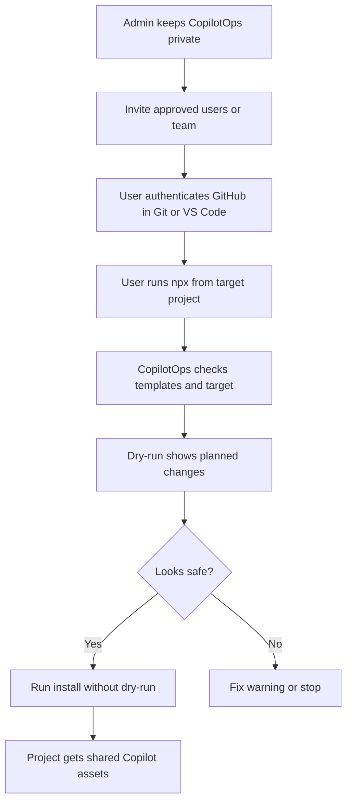
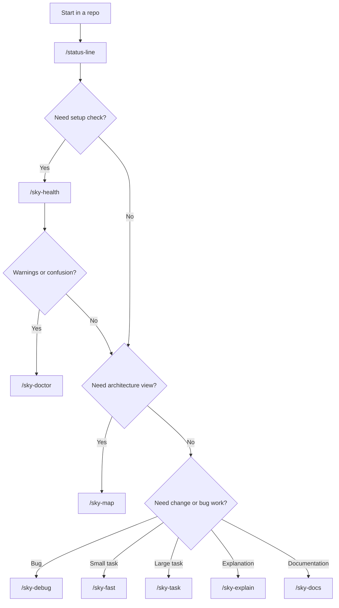
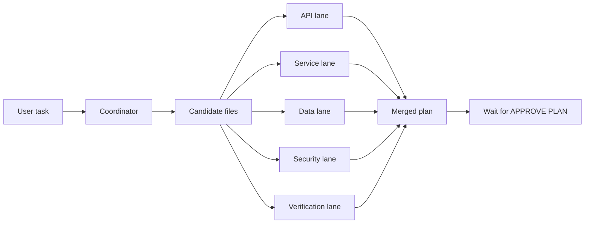

# CopilotOps Framework

CopilotOps Framework is a private GitHub Copilot workflow framework for team repositories.

It gives projects one shared source for GitHub Copilot instructions, reusable prompts, specialist skills, setup diagnostics, and safe installation.

Current framework version:

```text
1.3.0
```

## What It Provides

- Shared GitHub Copilot instructions.
- Shared user prompts such as `/sky-task`, `/sky-fast`, `/sky-debug`, `/sky-health`, `/sky-map`, and `/sky-doctor`.
- Internal specialist skills for API, service, data, security, performance, and verification.
- Token-saving specialist lane model.
- Planning safety with `APPROVE PLAN`.
- CLI commands for install, link, health, doctor, validate, and rollback.
- Codex install helper that copies CopilotOps skills and agent commands into the local Codex skills directory.
- Private GitHub repo install for invited users.

## Current Scope

This version of CopilotOps Framework is prepared for the Web Services team and focuses on backend development work.

It is designed for repositories that use patterns such as:

- C# / .NET backend services.
- APIs, controllers, handlers, services, validators, and DTOs.
- Data access, EF Core, repositories, queries, and migrations.
- Security, authorization, tenant isolation, and sensitive data checks.
- Backend testing and regression verification.

> [!WARNING]
> This framework version is being tested first with the Web Services workflow.
> If the results are good, we will create or adapt versions for other teams so each team gets prompts, skills, and instructions that match its own work.

## Private GitHub Install

Approved users can install from the private GitHub repo after they are invited and authenticated with GitHub.

Run from inside a target project:

```bash
cd C:\SharedProjects\CS_Datafactory_v2
npx --yes git+https://github.com/hjahouse/CopilotOps.git#dev install --dry-run
```

If the dry-run looks correct:

```bash
npx --yes git+https://github.com/hjahouse/CopilotOps.git#dev install
```

Run with an explicit target:

```bash
npx --yes git+https://github.com/hjahouse/CopilotOps.git#dev install --target C:\SharedProjects\CS_Datafactory_v2 --dry-run
```

Deep diagnostics:

```bash
npx --yes git+https://github.com/hjahouse/CopilotOps.git#dev doctor --target C:\SharedProjects\CS_Datafactory_v2
```

This model does not use npm publishing. Users need GitHub access to the private repo.

## Install Flow



## CLI Commands

| Command | Use When | Changes Files? | Notes |
|---|---|---:|---|
| `copilotops install` | Standard one-command project setup | Yes, unless `--dry-run` | Links Copilot-specific `.github` assets safely |
| `copilotops codex-install` | Make CopilotOps skills available in Codex | Yes, unless `--dry-run` | Copies `.github/skills` and converts `.github/agents/*.agent.md` to Codex skills |
| `copilotops init` | Copy templates instead of linking | Yes, unless `--dry-run` | Useful when a project needs a snapshot |
| `copilotops link` | Link project assets to central templates | Yes, unless `--dry-run` | Best for shared source-of-truth workflow |
| `copilotops health` | Check one target project | No | Fast project readiness check |
| `copilotops doctor` | Diagnose framework and target together | No | Stronger than health |
| `copilotops validate` | Validate CopilotOps framework repo | No | Run before publishing or pushing changes |
| `copilotops rollback` | Restore `.backup` Copilot assets | Yes, unless `--dry-run` | Use if install/link needs to be undone |

Local examples:

```bash
node ./bin/copilotops.js --help
node ./bin/copilotops.js validate --source C:\SharedProjects\CopilotOps
node ./bin/copilotops.js doctor --source C:\SharedProjects\CopilotOps --target C:\SharedProjects\CS_Datafactory_v2
node ./bin/copilotops.js install --source C:\SharedProjects\CopilotOps --target C:\SharedProjects\CS_Datafactory_v2 --dry-run
node ./bin/copilotops.js codex-install --source C:\SharedProjects\CopilotOps --dry-run
```

## Codex Install

Codex does not automatically load GitHub Copilot `.github/agents` or `.github/skills` from a repository. To use these workflows in Codex, copy them into the Codex skills directory:

```bash
cd C:\SharedProjects\CopilotOps
node .\bin\copilotops.js codex-install --dry-run
node .\bin\copilotops.js codex-install
```

Then open a new Codex session. Use the workflows by name, for example:

```text
use $status-line to show quick repo/session status
use $sky-task to plan this backend change
use $sky-health to check this repository
use $sky-debug to investigate this bug
```

## Prompt Commands

Prompt commands are the commands the user types in Copilot Chat. Use these first.

| Command | What It Does | Use When | Safety |
|---|---|---|---|
| `/status-line` | Shows quick repo/session status. | You want a fast starting point. | Read-only |
| `/sky-health` | Checks CopilotOps setup and repo readiness. | You want to know if the repo is ready. | Read-only |
| `/sky-doctor` | Runs deeper setup diagnostics and gives fix recommendations. | `/sky-health` shows warnings or setup looks wrong. | Read-only |
| `/sky-map` | Builds a high-level architecture map. | You are new to a repo or need the main project/layer map. | Read-only |
| `/sky-explain` | Explains code, flow, or behavior in simple language. | You need to understand something before changing it. | Read-only |
| `/sky-docs` | Creates clean documentation for a feature, endpoint, module, or flow. | You need markdown documentation from code. | Read-only / doc-focused |
| `/sky-pr` | Creates PR title/description from current changes. | You finished changes and need a clean PR summary. | Read-only |
| `/sky-investigate` | Investigates an issue with evidence and safe checks. | You need facts before deciding a fix. | Read-only |
| `/sky-forensics` | Reviews incident/data evidence carefully. | You need deeper incident or data investigation. | Read-only |
| `/sky-fast` | Makes a compact implementation plan. | Small or medium backend task. | Waits for `APPROVE PLAN` |
| `/sky-task` | Makes a full implementation plan using specialist lanes. | Large, risky, or cross-layer backend work. | Waits for `APPROVE PLAN` |
| `/sky-debug` | Finds root cause and proposes a small fix plan. | Bug, exception, failing test, or wrong output. | Waits for `APPROVE PLAN` |

## Choosing The Right Prompt



## Specialist Skills

Skills are internal helpers. Users normally do not type these directly. Prompt commands trigger them when their lane is useful.

| Skill | Triggered By | What It Checks | Use When |
|---|---|---|---|
| `sky-api` | `/sky-task`, `/sky-fast`, `/sky-debug` | Controllers, endpoints, routes, DTOs, response contracts. | API files or contracts may change. |
| `sky-service` | `/sky-task`, `/sky-fast`, `/sky-debug` | Services, handlers, validators, mappings, DI, business logic. | Business logic or service flow may change. |
| `sky-data` | `/sky-task`, `/sky-fast`, `/sky-debug`, `/sky-investigate` | EF Core, DbContext, entities, repositories, migrations, queries. | Data model, SQL, query, or migration behavior may change. |
| `sky-security` | `/sky-task`, `/sky-fast`, `/sky-debug` | Auth, authorization, tenant isolation, secrets, sensitive data. | Permissions, ownership, or sensitive data may be affected. |
| `sky-performance` | `/sky-task`, `/sky-fast`, `/sky-debug` | Query shape, async flow, hot paths, payload size, scalability. | A change may slow a query, endpoint, or background flow. |
| `sky-verification` | `/sky-task`, `/sky-fast`, `/sky-debug`, `/sky-investigate`, `/sky-forensics` | Manual verification, read-only SQL checks, API checks, log checks, live-safe validation. | You need practical checks that prove the result is safe. |
| `sky-evidence` | `/sky-investigate`, `/sky-forensics`, `/sky-pr` | Links claims to proof from code, SQL, logs, config, or repo files. | A finding needs evidence before acting on it. |
| `sky-risk` | `/sky-task`, `/sky-pr`, `/sky-investigate`, `/sky-forensics` | What can break, risk level, mitigation, rollback, safe next checks. | The change may affect production, data, security, or shared behavior. |
| `sky-decision` | `/sky-investigate`, `/sky-forensics`, `/sky-pr` | Compares options, tradeoffs, risk, effort, and reversibility. | There are two or more realistic paths and you need a recommendation. |
| `sky-change-summary` | `/sky-pr` | Summarizes current git changes with small focused diffs when needed. | You need a PR summary, handoff note, or change explanation. |

Simple rule:

- Type a prompt command when you need help.
- Let the prompt command choose the specialist skills.
- Use `APPROVE PLAN` only when you are ready for code changes.

## Token-Saving Specialist Lane Model

CopilotOps is designed to reduce token usage by using focused parallel specialist lanes instead of one large sequential investigation.

Core rule:

```text
Use small specialist lanes in parallel. Never give every agent the whole repository.
Send each lane only the task summary, candidate files, and exact question it must answer.
```



This is powerful because it keeps each investigation small, avoids reading unrelated files, and makes the final plan easier to review.

## Safety Rules

- Planning prompts must remain read-only until the user types `APPROVE PLAN`.
- Do not replace an entire project `.github` folder.
- Do not touch `.github/workflows`.
- Always run `install --dry-run` before real install.
- Test one project before broad rollout.
- Keep `.NET 6 / C# 10` guidance unless a project explicitly says otherwise.

## What Install Touches

CopilotOps only installs or links these assets:

```text
.github/copilot-instructions.md
.github/instructions
.github/prompts
.github/skills
```

It must not touch:

```text
.github/workflows
```

## Repository Structure

```text
CopilotOps
|-- package.json
|-- bin/
|   `-- copilotops.js
|-- src/
|   |-- cli.js
|   |-- commands/
|   |   |-- install.js
|   |   |-- init.js
|   |   |-- link.js
|   |   |-- health.js
|   |   |-- doctor.js
|   |   |-- validate.js
|   |   `-- rollback.js
|   `-- lib/
|-- .github/
|   |-- copilot-instructions.md
|   |-- agents/
|   |-- instructions/
|   `-- skills/
|-- templates/
|   `-- .github/
|       |-- copilot-instructions.md
|       |-- agents/
|       |-- instructions/
|       `-- skills/
|-- docs/
|-- VERSION
|-- CHANGELOG.md
`-- README.md
```

## Versioning

CopilotOps uses semantic versioning:

* `1.2.1` for small fixes or safe prompt wording updates.
* `1.3.0` for new prompts, new skills, or new CLI commands.
* `2.0.0` for breaking changes or changed safety behavior.

## User Checklist

1. Accept the GitHub repo invite.
2. Confirm Git and Node.js are installed.
3. Open the target project folder.
4. Run:

```bash
npx --yes git+https://github.com/hjahouse/CopilotOps.git#dev install --dry-run
```

5. If safe, run:

```bash
npx --yes git+https://github.com/hjahouse/CopilotOps.git#dev install
```

## Documentation

* `docs/COMMAND_CATALOG.md`
* `docs/TEAM_ONBOARDING.md`
* `docs/PRIVATE_GITHUB_INSTALL.md`
* `docs/PRIVATE_GITHUB_USER_GUIDE.html`
* `docs/COPILOTOPS_FRAMEWORK_SHOWCASE.html`
* `docs/ADMIN_SETUP.md`
* `docs/decisions/0001-use-copilotops-as-shared-ai-tooling.md`
