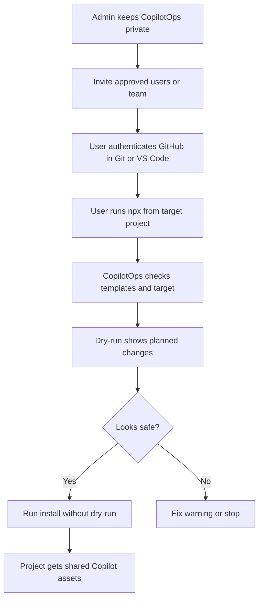
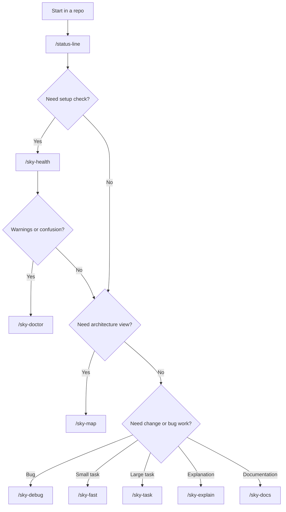
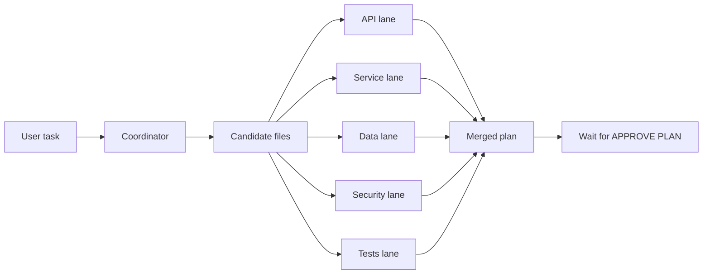

# CopilotOps Framework

CopilotOps Framework is a private GitHub Copilot workflow framework for team repositories.

It gives projects one shared source for GitHub Copilot instructions, reusable prompts, specialist skills, setup diagnostics, and safe installation.

Current framework version:

```text
1.2.0
```

## What It Provides

- Shared GitHub Copilot instructions.
- Shared user prompts such as `/sky-task`, `/sky-fast`, `/sky-debug`, `/sky-health`, `/sky-map`, and `/sky-doctor`.
- Internal specialist skills for API, service, data, security, performance, and tests.
- Token-saving specialist lane model.
- Planning safety with `APPROVE PLAN`.
- CLI commands for install, link, health, doctor, validate, and rollback.
- Private GitHub repo install for invited users.

## Private GitHub Install

Approved users can install from the private GitHub repo after they are invited and authenticated with GitHub.

Run from inside a target project:

```bash
cd C:\SharedProjects\CS_Datafactory_v2
npx --yes git+https://github.com/hjahouse/CopilotOps.git#dev install --dry-run
```

If the dry-run looks correct:

```bash
npx --yes git+https://github.com/hjahouse/CopilotOps.git#dev install
```

Run with an explicit target:

```bash
npx --yes git+https://github.com/hjahouse/CopilotOps.git#dev install --target C:\SharedProjects\CS_Datafactory_v2 --dry-run
```

Deep diagnostics:

```bash
npx --yes git+https://github.com/hjahouse/CopilotOps.git#dev doctor --target C:\SharedProjects\CS_Datafactory_v2
```

This model does not use npm publishing. Users need GitHub access to the private repo.

## Install Flow



## CLI Commands

| Command | Use When | Changes Files? | Notes |
|---|---|---:|---|
| `copilotops install` | Standard one-command project setup | Yes, unless `--dry-run` | Links Copilot-specific `.github` assets safely |
| `copilotops init` | Copy templates instead of linking | Yes, unless `--dry-run` | Useful when a project needs a snapshot |
| `copilotops link` | Link project assets to central templates | Yes, unless `--dry-run` | Best for shared source-of-truth workflow |
| `copilotops health` | Check one target project | No | Fast project readiness check |
| `copilotops doctor` | Diagnose framework and target together | No | Stronger than health |
| `copilotops validate` | Validate CopilotOps framework repo | No | Run before publishing or pushing changes |
| `copilotops rollback` | Restore `.backup` Copilot assets | Yes, unless `--dry-run` | Use if install/link needs to be undone |

Local examples:

```bash
node ./bin/copilotops.js --help
node ./bin/copilotops.js validate --source C:\SharedProjects\CopilotOps
node ./bin/copilotops.js doctor --source C:\SharedProjects\CopilotOps --target C:\SharedProjects\CS_Datafactory_v2
node ./bin/copilotops.js install --source C:\SharedProjects\CopilotOps --target C:\SharedProjects\CS_Datafactory_v2 --dry-run
```

## Prompt Commands

| Prompt | Use When | Output | Safety |
|---|---|---|---|
| `/status-line` | You want quick repo/session status | Compact status block | Read-only |
| `/sky-health` | You want to verify CopilotOps setup | Health report | Read-only |
| `/sky-doctor` | `/sky-health` is not enough or setup looks wrong | Diagnostic report and fixes | Read-only |
| `/sky-map` | You need a high-level architecture map | Project map and Mermaid diagram | Read-only |
| `/sky-explain` | You need code or flow explained simply | Plain-language explanation | Read-only |
| `/sky-docs` | You need documentation for a module, endpoint, or flow | Markdown documentation | Read-only |
| `/sky-fast` | Small or medium backend task | Compact plan | Waits for `APPROVE PLAN` |
| `/sky-task` | Large, risky, or cross-layer backend work | Full implementation plan | Waits for `APPROVE PLAN` |
| `/sky-debug` | Bug, exception, failing test, wrong output | Root cause and fix plan | Waits for `APPROVE PLAN` |

## Choosing The Right Prompt



## Internal Specialist Skills

These skills are normally used by `/sky-task`, `/sky-fast`, and `/sky-debug`. They keep analysis focused and reduce token usage.

| Skill | Use For | Typical Questions |
|---|---|---|
| `sky-api` | Controllers, endpoints, DTOs, routes, response contracts | What API files change? Does the contract change? |
| `sky-service` | Services, handlers, validators, mappings, DI, business logic | What business logic changes? What side effects exist? |
| `sky-data` | EF Core, DbContext, entities, repositories, migrations, queries | What data model/query changes are needed? |
| `sky-security` | Auth, authorization, tenant isolation, secrets, sensitive data | Does this affect permissions or sensitive data? |
| `sky-performance` | Query shape, async flow, hot paths, payload size, scalability | Could this create slow queries or heavy payloads? |
| `sky-tests` | Existing test patterns, regression coverage, manual verification | What tests or manual checks prove this works? |

## Token-Saving Specialist Lane Model

CopilotOps is designed to reduce token usage by using focused parallel specialist lanes instead of one large sequential investigation.

Core rule:

```text
Use small specialist lanes in parallel. Never give every agent the whole repository.
Send each lane only the task summary, candidate files, and exact question it must answer.
```



This is powerful because it keeps each investigation small, avoids reading unrelated files, and makes the final plan easier to review.

## Safety Rules

- Planning prompts must remain read-only until the user types `APPROVE PLAN`.
- Do not replace an entire project `.github` folder.
- Do not touch `.github/workflows`.
- Always run `install --dry-run` before real install.
- Test one project before broad rollout.
- Keep `.NET 6 / C# 10` guidance unless a project explicitly says otherwise.

## What Install Touches

CopilotOps only installs or links these assets:

```text
.github/copilot-instructions.md
.github/instructions
.github/prompts
.github/skills
```

It must not touch:

```text
.github/workflows
```

## Repository Structure

```text
CopilotOps
|-- package.json
|-- bin/
|   `-- copilotops.js
|-- src/
|   |-- cli.js
|   |-- commands/
|   |   |-- install.js
|   |   |-- init.js
|   |   |-- link.js
|   |   |-- health.js
|   |   |-- doctor.js
|   |   |-- validate.js
|   |   `-- rollback.js
|   `-- lib/
|-- .github/
|   |-- copilot-instructions.md
|   |-- instructions/
|   |-- prompts/
|   `-- skills/
|-- templates/
|   `-- .github/
|       |-- copilot-instructions.md
|       |-- instructions/
|       |-- prompts/
|       `-- skills/
|-- docs/
|-- VERSION
|-- CHANGELOG.md
`-- README.md
```

## Versioning

CopilotOps uses semantic versioning:

* `1.2.1` for small fixes or safe prompt wording updates.
* `1.3.0` for new prompts, new skills, or new CLI commands.
* `2.0.0` for breaking changes or changed safety behavior.

## User Checklist

1. Accept the GitHub repo invite.
2. Confirm Git and Node.js are installed.
3. Open the target project folder.
4. Run:

```bash
npx --yes git+https://github.com/hjahouse/CopilotOps.git#dev install --dry-run
```

5. If safe, run:

```bash
npx --yes git+https://github.com/hjahouse/CopilotOps.git#dev install
```

## Documentation

* `docs/COMMAND_CATALOG.md`
* `docs/TEAM_ONBOARDING.md`
* `docs/PRIVATE_GITHUB_INSTALL.md`
* `docs/PRIVATE_GITHUB_USER_GUIDE.html`
* `docs/ADMIN_SETUP.md`
* `docs/decisions/0001-use-copilotops-as-shared-ai-tooling.md`
