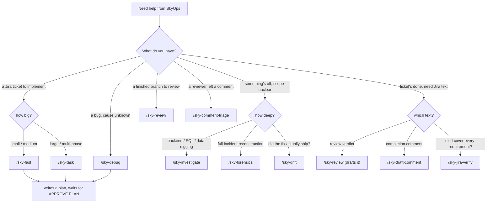

# Choosing a Command

The planning/investigate commands overlap on purpose — they trade depth for speed differently. This is the quick way to pick.

## The distinctions that matter

- **[[sky-fast]] vs [[sky-task]]** — same `APPROVE PLAN` gate, different cost. `sky-fast` inspects directly for small work; `sky-task` dispatches the full plan-stage skill set and writes phases/waves for larger work.
- **[[sky-debug]] vs [[sky-investigate]] vs [[sky-forensics]]** — increasing scope. `sky-debug` traces one bug to the smallest fix. `sky-investigate` digs wider across backend/SQL/data/incident. `sky-forensics` is full incident reconstruction.
- **[[sky-drift]]** isn't about finding a bug — it's about whether a fix that was already written actually merged and is actually running.
- **[[sky-review]] vs [[sky-comment-triage]]** — `sky-review` is the full orchestrated pass; `sky-comment-triage` verifies one specific reviewer comment is even right before acting on it.

## See also

[[Working Flow]] · [[Home]]
