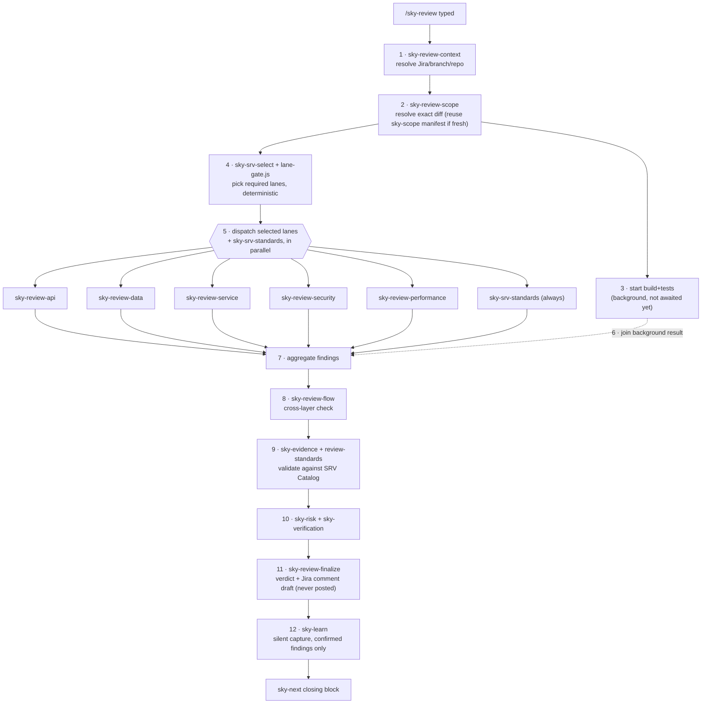

# Review Pipeline — `/sky-review`

Full orchestration, in exact order. See [[sky-review]] for the command note.

1. **Gather context** — [[sky-review-context]] resolves Jira summary/description/AC/comments/repos/branches/assumptions. Resolution priority: explicit user instruction → latest "Branches for review" comment → latest relevant comment → ticket description.
2. **Build ticket scope** — [[sky-review-scope]]. Reuses a fresh [[sky-scope]] manifest (`.skyops/scope/<key>.scope.md`) if its `head_sha` matches current `HEAD`; otherwise rediscovers and says so. Scope anchor is ticket-tagged commits (`git log --grep=<KEY>`), never a raw branch-vs-master diff.
3. **Start build+tests in background** — smallest affected scope, output redirected to a log, real exit code read (never judged from a pipe). Does not block lane dispatch.
4. **Plan specialist lanes** — [[sky-srv-select]] shortlists plausible SRV codes (a focusing aid, does not replace the full sweep). Lane *selection* is deterministic, done by `scripts/lane-gate.js` (no model call, no repo read) — pattern-matches changed files against 5 rulesets:
   - **api** — controller/endpoints/routes/DTO/contracts
   - **service** — handler/service/manager/commands/queries/usecase, or *any* `.cs` file (catch-all)
   - **data** — repository/entity/DbContext/migration/`.sql`/models
   - **security** — auth/permission/role/tenant/validator/token/secret/cors/policy/identity, or *any controller*
   - **performance** — repository/query/cache/batch/jobs/worker/bulk/grid/paging/`.sql`

   Ignored: `obj/bin/node_modules/dist`, `.md/.txt/.json/.yaml/.lock/.png/.svg/.ico`, `*.Designer.cs`. Asymmetric rule: `sky-review` may *add* a lane the gate skipped (must state why) but may **never drop** a required lane. [[sky-srv-standards]] sits outside this selection — mandatory on every review regardless.
5. **Dispatch every selected lane + `sky-srv-standards` in parallel**, one message, concurrent with the still-running build/tests. Each lane agent gets only: relevant AC summary, relevant changed hunks, one-hop context, `C:\SharedProjects\SkyOps\standards` (never the stale `~/.claude/standards` copy), the relevant SRV subset, repo path/branch/commit. Never the full repo.
6. **Join build/test result** — must wait here; never finalize on an unjoined/assumed result.
7. **Aggregate** — merge duplicate findings, keep strongest severity + clearest evidence.
8. **Cross-flow review** — [[sky-review-flow]], mandatory when the ticket crosses more than one architectural component. 11-point end-to-end check; canonical failure mode it catches: *Controller sends CustomerId → Service treats it as AccountId → Repository query is locally valid* — locally-correct-but-globally-wrong.
9. **Validate findings** — [[sky-evidence]] + [[review-standards]]. Every surviving finding needs severity, category, SRV code (or "not catalogued"), file, narrow location, offending behavior, risk, required change, evidence, confidence. Drops speculative/unsupported/unrelated-legacy/style-only/out-of-scope findings.
10. **Risk and verification** — [[sky-risk]] + [[sky-verification]], surfacing only material risks/gaps, never claiming live verification happened.
11. **Finalize** — [[sky-review-finalize]] applies the deterministic verdict rubric (below) and formats the report + a paste-ready Jira comment. **Never posts it.**
12. **Capture** — [[sky-learn]] runs silently after the report, only for findings with real `file:line` proof. Duplicate lessons increment a `hits` counter — see [[Async Change Guard Pattern]] for how that promotes a lesson into a guard.

## Verdict rubric ([[sky-review-finalize]])

- **Block** — proven Critical, severe security/data-integrity defect, or a build/test failure equivalent to Critical
- **Request Changes** — blocking High, or a Medium that blocks an AC, or multiple unsafe Mediums
- **Approve With Comments** — non-blocking Medium/Low/Optional only
- **Approve** — clean

## Agents dispatched (by name, never the skill names)

[[sky-review-api]] · [[sky-review-service]] · [[sky-review-data]] · [[sky-review-security]] · [[sky-review-performance]] (selected by lane-gate) · [[sky-srv-standards]] (always)

## See also

[[Async Change Guard Pattern]] · [[SRV Catalog]] · [[Working Flow]]
