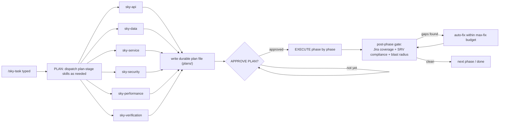
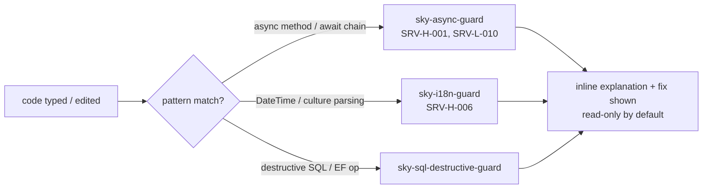

# Working Flow — end to end

Synthesized call chains for the two major top-level commands, plus where the write-time guards sit relative to both.

## `/sky-review CLS-XXXX`

[[sky-review]] typed → [[sky-review-context]] resolves Jira/branch/repo → [[sky-review-scope]] resolves the exact commit-tagged diff, reusing a [[sky-scope]] manifest if fresh → build+tests launched in background (not yet awaited) → [[sky-srv-select]] shortlists plausible SRVs while `lane-gate.js` deterministically picks required review lanes from the changed-file list → all selected [[sky-review-api|sky-review-*]] agents + mandatory [[sky-srv-standards]] agent dispatched together in one parallel batch, each given only its slice of context → background build/test result joined → findings aggregated → [[sky-review-flow]] runs the mandatory cross-layer check → [[sky-evidence]] + [[review-standards]] validate every finding against [[SRV Catalog]] → [[sky-risk]] + [[sky-verification]] add risk/verification framing → [[sky-review-finalize]] applies the deterministic verdict rubric and formats the report + Jira-paste-ready comment (never posted) → [[sky-learn]] silently captures only the confirmed, evidence-backed findings → [[sky-next]] closing block names the one best next command.

Full step-by-step: [[Review Pipeline]].

## `/sky-task CLS-XXXX`

PLAN stage runs the 6 plan-stage skills ([[sky-api]] / [[sky-data]] / [[sky-service]] / [[sky-security]] / [[sky-performance]] / [[sky-verification]]) as needed in parallel to inspect read-only, writes one durable plan file (`plans/`) with numbered requirements mapped to phases/waves, and **stops** for the user to type `APPROVE PLAN`. Only then does EXECUTE begin: implement phase by phase, with a post-phase gate re-checking Jira coverage + SRV compliance + blast radius and auto-fixing within the `max-fix` budget before the next phase.

[[sky-fast]] follows the same `APPROVE PLAN` gate but for small/medium tasks, using direct inspection instead of dispatching the plan-stage skills except where a lane is genuinely independent.

[[sky-debug]] is the read-only variant — traces root cause via the same parallel specialist lanes, proposes the smallest fix, and also waits for `APPROVE PLAN` before any edit.

## Write-time guards — orthogonal to both flows

[[sky-async-guard]], [[sky-i18n-guard]], [[sky-sql-destructive-guard]] self-fire (`disable-model-invocation: false`) the instant matching code is typed or edited during *any* session, independent of which top-level command is active. Each is explicitly narrower and faster than a full [[sky-review]] pass over the same SRV codes — see [[Async Change Guard Pattern]].

## See also

[[Repo Overview]] · [[Review Pipeline]] · [[Hooks]]
